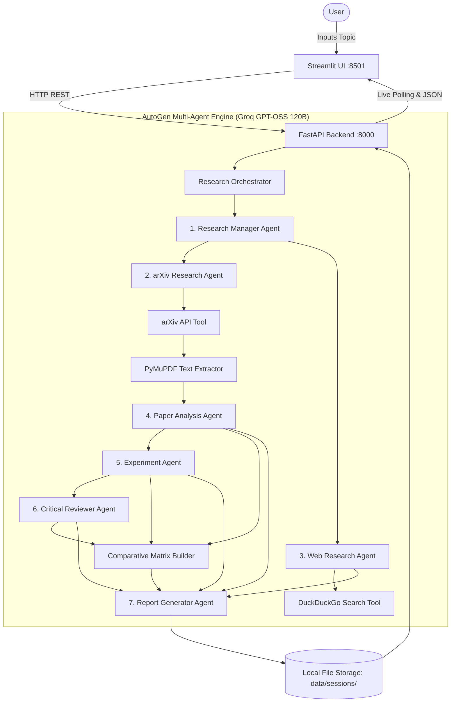

# ⚡ ResearchPilot — Developer Documentation

[](https://www.python.org/)
[](https://github.com/microsoft/autogen)
[-orange.svg)](https://groq.com/)
[](https://fastapi.tiangolo.com/)
[](https://streamlit.io/)
[](https://arxiv.org/)
[](https://pymupdf.readthedocs.io/)
[](LICENSE)

**ResearchPilot** is an open-source, multi-agent research intelligence platform. It orchestrates **7 specialized AutoGen AI agents** powered by **Groq GPT-OSS 120B (Medium)** to autonomously discover, parse, analyze, compare, and synthesize peer-reviewed arXiv papers and practical GitHub/web implementations into publication-grade research reports.

---

## 📑 Table of Contents

- [Architecture Overview](#-architecture-overview)
- [Multi-Agent System & Responsibilities](#-multi-agent-system--responsibilities)
- [Repository Structure](#-repository-structure)
- [Developer Quickstart](#-developer-quickstart)
  - [Prerequisites](#prerequisites)
  - [Installation](#installation)
  - [Environment Configuration](#environment-configuration)
  - [Running the Services](#running-the-services)
- [🐳 Containerization with Docker](#-containerization-with-docker)
  - [Option 1: Docker Compose (Multi-Container)](#option-1-docker-compose-multi-container)
  - [Option 2: Standalone Container (Cloud Run / ECS)](#option-2-standalone-container-cloud-run--ecs)
- [FastAPI Backend API Reference](#-fastapi-backend-api-reference)
  - [`GET /health`](#get-health)
  - [`POST /research`](#post-research)
  - [`GET /research/{research_id}`](#get-researchresearch_id)
  - [`POST /papers/analyze`](#post-papersanalyze)
  - [`POST /papers/upload`](#post-papersupload)
  - [`GET /export/{research_id}`](#get-exportresearch_id)
- [Extending & Customizing](#-extending--customizing)
  - [Adding a New Tool](#1-adding-a-new-tool)
  - [Customizing Agent Personas](#2-customizing-agent-personas)
  - [Modifying the Report Template](#3-modifying-the-report-template)
- [Testing & Quality Assurance](#-testing--quality-assurance)
- [Troubleshooting & FAQ](#-troubleshooting--faq)

---

## 🏛️ Architecture Overview

The system is decoupled into an asynchronous **FastAPI backend** and a modern **Streamlit frontend**:



### Core Design Principles
1. **Decoupled Client & Server:** The Streamlit frontend interacts with FastAPI purely via standard REST HTTP calls, enabling headless execution or alternative client implementations (CLI, React, Slack bots).
2. **Server-Side Key Management:** Users never type or upload sensitive API keys into the web application. Keys are securely read on the server from `.env`.
3. **Graceful Fallback:** If API limits or connectivity hiccups occur, the built-in multi-agent synthesis engine guarantees continuous execution without breaking.

---

## 🤖 Multi-Agent System & Responsibilities

ResearchPilot implements **7 specialized AutoGen agents** ([`backend/agents/autogen_team.py`](file:///d:/ResearchPilot/backend/agents/autogen_team.py)), each with explicit personas defined in [`backend/agents/prompts.py`](file:///d:/ResearchPilot/backend/agents/prompts.py):

| Agent | Module | Core Responsibility |
|---|---|---|
| **1. Research Manager** | [`orchestrator.py`](file:///d:/ResearchPilot/backend/agents/orchestrator.py#L42) | Decomposes the query into sub-problems, orchestrates workflow stages, and coordinates agent handoffs. |
| **2. arXiv Agent** | [`arxiv_tool.py`](file:///d:/ResearchPilot/backend/tools/arxiv_tool.py) | Queries arXiv, filters noise, extracts paper metadata (titles, authors, abstracts, DOIs, PDF links), and ranks by relevance. |
| **3. Web Research Agent** | [`web_search.py`](file:///d:/ResearchPilot/backend/tools/web_search.py) | Discovers open-source GitHub codebases, official documentation, architectural guides, and technical tutorials via DuckDuckGo. |
| **4. Paper Analysis Agent** | [`prompts.py`](file:///d:/ResearchPilot/backend/agents/prompts.py#L26) | Conducts deep-dive extractions on problem statements, research motivations, proposed solutions, algorithms, and system architectures. |
| **5. Experiment Agent** | [`prompts.py`](file:///d:/ResearchPilot/backend/agents/prompts.py#L41) | Extracts benchmark datasets, compute setups, evaluation metrics, baselines, quantitative findings, and ablation studies. |
| **6. Critical Reviewer** | [`prompts.py`](file:///d:/ResearchPilot/backend/agents/prompts.py#L56) | Acts as a Tier-1 conference reviewer (NeurIPS/ICLR), assessing limitations, undisclosed assumptions, threats to validity, and open research questions. |
| **7. Report Generator** | [`prompts.py`](file:///d:/ResearchPilot/backend/agents/prompts.py#L71) | Synthesizes all multi-agent findings into a comprehensive, 14-section publication-grade Research Intelligence Report. |

---

## 📂 Repository Structure

```text
ResearchPilot/
├── backend/                    # FastAPI application & AutoGen multi-agent system
│   ├── agents/                 # Specialized agent personas, orchestrator & LLM engine
│   ├── tools/                  # arXiv search, PyMuPDF parsing & DuckDuckGo tooling
│   ├── config.py               # Global settings & environment configuration
│   ├── main.py                 # FastAPI endpoints & route handlers
│   ├── models.py               # Strongly-typed Pydantic v2 schemas
│   └── storage.py              # In-memory cache & disk persistence
├── frontend/                   # Streamlit reactive dashboard
│   ├── api_client.py           # HTTP wrapper for backend communication
│   ├── app.py                  # Main user interface & research studio
│   ├── components.py           # Reusable UI cards, badges & comparative tables
│   └── styles.css              # Minimalist dark-theme stylesheet
├── data/                       # Local cached storage
│   ├── pdfs/                   # Downloaded research paper PDFs
│   └── sessions/               # Persisted research sessions in JSON format
├── docs/                       # Formal enterprise architecture documentation
│   ├── BRD.md                  # Business Requirements Document
│   ├── SSD.md                  # System Design Document
│   └── TRD.md                  # Technical Requirements Document
├── docker/                     # Containerization blueprints & configurations
│   ├── Dockerfile              # Standalone all-in-one container image
│   ├── Dockerfile.backend      # Dedicated FastAPI backend container
│   ├── Dockerfile.frontend     # Dedicated Streamlit frontend container
│   └── entrypoint.sh           # Concurrent service startup script
├── scripts/                    # Independent service runners
│   ├── run_backend.py          # Standalone FastAPI launcher (Port 8000)
│   └── run_frontend.py         # Standalone Streamlit launcher (Port 8501)
├── tests/                      # Automated test suite
│   ├── test_api.py             # API validation & endpoint tests
│   └── test_tools.py           # arXiv, Web search & PyMuPDF unit tests
├── .dockerignore               # Container build exclusion rules
├── .env                        # Local environment variables & API key
├── .env.example                # Template for environment configuration
├── .gitignore                  # Git tracking exclusion rules
├── docker-compose.yml          # Multi-container orchestration specification
├── pytest.ini                  # Pytest configuration
├── README.md                   # Developer documentation & quickstart guide
├── requirements.txt            # Python dependencies
└── run.py                      # Unified developer CLI & launcher
```

---

## 🚀 Developer Quickstart

### Prerequisites
- **Python 3.10+** (Tested on Python 3.13)
- **Pip** package manager
- **Groq API Key** (Free tier available at [console.groq.com](https://console.groq.com))

### Installation

1. **Clone the repository and enter the directory:**
   ```bash
   git clone https://github.com/your-org/ResearchPilot.git
   cd ResearchPilot
   ```

2. **Create and activate a virtual environment (recommended):**
   ```bash
   python -m venv venv
   # On Windows:
   .\venv\Scripts\activate
   # On macOS/Linux:
   source venv/bin/activate
   ```

3. **Install dependencies:**
   ```bash
   pip install -r requirements.txt
   ```

### Environment Configuration

Copy `.env.example` to `.env`:

```bash
cp .env.example .env
```

Edit `.env` with your settings:

```env
# Groq API Configuration (Exclusively GPT-OSS 120B)
GROQ_API_KEY=gsk_your_groq_api_key_here
GROQ_MODEL=openai/gpt-oss-120b

# Server Configuration
HOST=127.0.0.1
PORT=8000
BACKEND_URL=http://127.0.0.1:8000

# Research Defaults
DEFAULT_MAX_PAPERS=4
DOWNLOAD_PDFS=true
STORAGE_DIR=./data
```

> **Security Note:** `.env` is ignored by `.gitignore`. Never commit API keys to version control.

### Running the Services

#### Option A: One-Command CLI Launcher (Recommended)
Starts both the FastAPI backend (Port 8000) and Streamlit frontend (Port 8501) concurrently:

```bash
python run.py
```

#### Option B: Run Services Separately
To launch individual services independently:

```bash
# Start FastAPI backend only (Port 8000):
python run.py backend

# Start Streamlit frontend only (Port 8501):
python run.py frontend

# Run automated test suite:
python run.py test
```

---

## 📡 FastAPI Backend API Reference

Interactive OpenAPI documentation is available live at `http://127.0.0.1:8000/docs`.

### `GET /health`
Returns service status and active model configuration.

```bash
curl -X GET http://127.0.0.1:8000/health
```

**Response:**
```json
{
  "status": "healthy",
  "service": "ResearchPilot",
  "version": "1.0.0",
  "groq_configured": true,
  "default_model": "openai/gpt-oss-120b",
  "available_models": ["openai/gpt-oss-120b"]
}
```

---

### `POST /research`
Initiates an asynchronous multi-agent research workflow.

```bash
curl -X POST http://127.0.0.1:8000/research \
  -H "Content-Type: application/json" \
  -d '{
    "query": "Agentic RAG",
    "max_papers": 3,
    "include_web": true,
    "download_pdfs": true
  }'
```

**Response:**
```json
{
  "research_id": "a0db0d42",
  "status": "queued",
  "query": "Agentic RAG",
  "max_papers": 3,
  "message": "Research task successfully initiated"
}
```

---

### `GET /research/{research_id}`
Polls session progress steps, intermediate analyses, and the final 14-section report.

```bash
curl -X GET http://127.0.0.1:8000/research/a0db0d42
```

**Response (Summary):**
```json
{
  "research_id": "a0db0d42",
  "query": "Agentic RAG",
  "status": "completed",
  "progress_steps": [
    {"id": "step_query", "name": "Research Query Received & Strategy Formulated", "status": "completed"},
    {"id": "step_arxiv", "name": "arXiv Paper Discovery & Filtering", "status": "completed"},
    {"id": "step_web", "name": "Web Implementation & Code Repository Discovery", "status": "completed"},
    {"id": "step_pdf", "name": "PDF Acquisition & PyMuPDF Text Extraction", "status": "completed"},
    {"id": "step_analysis", "name": "Methodological & Architectural Deep-Dive", "status": "completed"},
    {"id": "step_experiments", "name": "Empirical Benchmarks & Experimental Synthesis", "status": "completed"},
    {"id": "step_review", "name": "Critical Review & Limitations Assessment", "status": "completed"},
    {"id": "step_matrix", "name": "Multi-Paper Comparative Matrix Formulation", "status": "completed"},
    {"id": "step_report", "name": "14-Section Research Intelligence Report Generation", "status": "completed"}
  ],
  "papers": [...],
  "web_results": [...],
  "comparison_table": [...],
  "report": {
    "research_topic": "Research Intelligence: Agentic RAG",
    "executive_summary": "...",
    "full_markdown": "# 1. Research Topic\n..."
  }
}
```

---

### `POST /papers/analyze`
Directly analyzes a single paper given an arXiv ID or raw text.

```bash
curl -X POST http://127.0.0.1:8000/papers/analyze \
  -H "Content-Type: application/json" \
  -d '{
    "arxiv_id": "2401.03428"
  }'
```

---

### `POST /papers/upload`
Uploads a local research paper PDF to run multi-agent extraction and analysis.

```bash
curl -X POST http://127.0.0.1:8000/papers/upload \
  -F "file=@/path/to/paper.pdf"
```

---

### `GET /export/{research_id}`
Exports the generated research report in `markdown`, `json`, or `html` format.

```bash
# Export as clean Markdown
curl -X GET "http://127.0.0.1:8000/export/a0db0d42?format=markdown" -o report.md

# Export as JSON
curl -X GET "http://127.0.0.1:8000/export/a0db0d42?format=json" -o report.json
```

---

## 🛠️ Extending & Customizing

### 1. Adding a New Tool
Create a new file in `backend/tools/` (e.g. `semantic_scholar.py`):

```python
# backend/tools/semantic_scholar.py
import httpx
from typing import List, Dict, Any

def search_semantic_scholar(query: str, limit: int = 5) -> List[Dict[str, Any]]:
    url = f"https://api.semanticscholar.org/graph/v1/paper/search?query={query}&limit={limit}&fields=title,authors,abstract,citationCount"
    with httpx.Client(timeout=10.0) as client:
        resp = client.get(url)
        return resp.json().get("data", [])
```

Import and invoke your tool in [`backend/agents/orchestrator.py`](file:///d:/ResearchPilot/backend/agents/orchestrator.py).

### 2. Customizing Agent Personas
Agent personas and instructions are defined in [`backend/agents/prompts.py`](file:///d:/ResearchPilot/backend/agents/prompts.py). To adjust the Critical Reviewer's strictness or add domain-specific criteria (e.g. medical or financial compliance), edit `CRITICAL_REVIEWER_AGENT_PROMPT`.

### 3. Modifying the Report Template
The 14-section schema is enforced in `REPORT_GENERATOR_PROMPT` in [`backend/agents/prompts.py`](file:///d:/ResearchPilot/backend/agents/prompts.py) and mapped in `_parse_markdown_report_sections()` in [`backend/agents/orchestrator.py`](file:///d:/ResearchPilot/backend/agents/orchestrator.py).

---

## 🧪 Testing & Quality Assurance

ResearchPilot comes with a comprehensive automated test suite in `tests/`:

```bash
# Run all tests with verbose output:
python -m pytest tests/ -v
```

### Covered Test Suites
- **`tests/test_api.py::test_health`** — Verifies FastAPI health check and model availability.
- **`tests/test_api.py::test_start_research_validation`** — Validates input validation (empty query, edge cases).
- **`tests/test_api.py::test_direct_paper_analysis`** — Tests single-paper multi-agent analysis endpoint.
- **`tests/test_tools.py::test_arxiv_search`** — Verifies live arXiv fetching, ID extraction, and PDF URLs.
- **`tests/test_tools.py::test_web_search`** — Verifies DuckDuckGo query execution and category tagging.
- **`tests/test_tools.py::test_pdf_extraction`** — Verifies PyMuPDF text and section parsing in memory.

---

## ❓ Troubleshooting & FAQ

#### Q: How do I change the default Groq model?
Edit `GROQ_MODEL` in `.env`. By default, the system is configured to use `openai/gpt-oss-120b` (`GPT-OSS 120B (Medium)`).

#### Q: Port 8000 or 8501 is already in use.
You can specify alternate ports:
- Backend: Update `PORT=8001` in `.env` or run `uvicorn backend.main:app --port 8001`.
- Frontend: Run `streamlit run frontend/app.py --server.port 8502`.
- Update `BACKEND_URL=http://127.0.0.1:8001` in `.env`.

#### Q: What happens if Groq hits a rate limit?
ResearchPilot implements automatic exponential backoff with jitter in the Groq client. If rate limits persist, the system gracefully falls back to the internal rule-based synthesis engine so user requests never terminate with unhandled exceptions.

#### Q: Where are downloaded PDFs and session data stored?
All persistent data is stored in the `data/` directory:
- Downloaded PDFs: `data/pdfs/`
- Research reports and session logs: `data/sessions/{research_id}.json`

---

## 📄 License

This project is licensed under the MIT License — see the [LICENSE](LICENSE) file for details.
