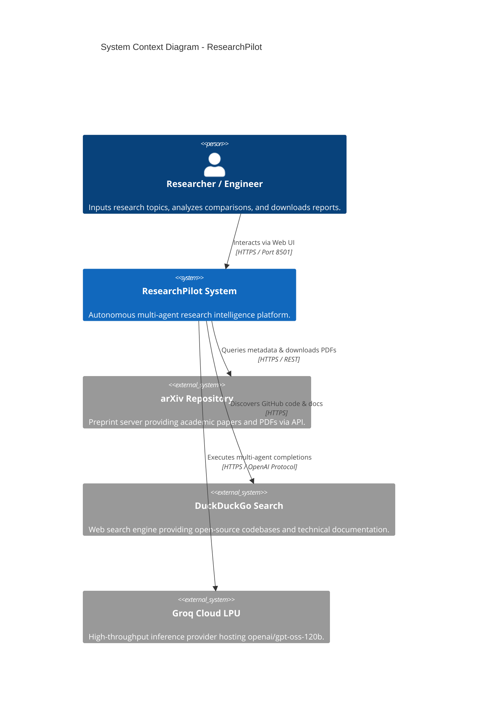
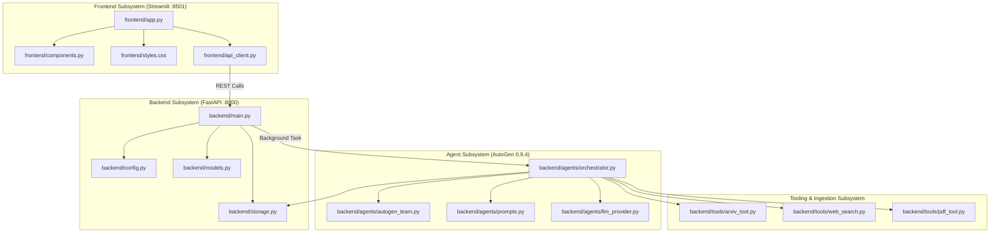
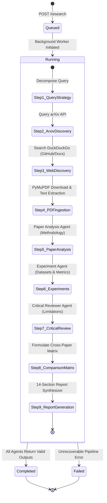
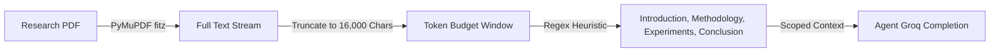

# System Design Document (SSD)
## ResearchPilot — Autonomous Multi-Agent Research Intelligence Platform

**Document Version:** 1.0.0  
**Status:** Approved Architecture  
**Scope:** Complete End-to-End System Design & Component Specifications  

---

## 1. Architectural Blueprint & System Goals

ResearchPilot is an enterprise-grade AI research assistant engineered around four core architectural pillars:

1. **Autonomous Multi-Agent Specialization:** Rather than relying on a single monolithic prompt, research tasks are segmented across 7 specialized AutoGen agents mimicking an academic research laboratory.
2. **Decoupled Client-Server Topology:** The presentation layer (Streamlit) communicates with the backend (FastAPI) exclusively via standard REST HTTP, allowing independent scaling, testing, and UI replacement.
3. **High-Throughput Inference:** Integrated with Groq's LPU hardware executing `openai/gpt-oss-120b` (`GPT-OSS 120B (Medium)`), ensuring multi-turn agent deliberations conclude in seconds rather than minutes.
4. **Deterministic Fault Tolerance:** Multi-layered fallbacks (arXiv XML feed, curated web fallbacks, and internal rule synthesis) ensure the pipeline never terminates with uncaught exceptions.

---

## 2. High-Level System Architecture (C4 Model)



---

## 3. Component Decomposition



---

## 4. State Machine & Execution Lifecycle

Every research request progresses through a deterministic, observable state machine:



---

## 5. Detailed Component Design

### 5.1 Presentation Layer (`frontend/`)
- **`app.py`:** The primary reactive application. Manages Streamlit session state (`active_research_id`, `search_query`), executes client-side polling every 1.5 seconds during execution, and renders the tabbed deliverables upon completion.
- **`components.py`:** Modular UI renderers:
  - `render_header()`: Renders the branded hero header with the `GPT-OSS 120B (Medium)` badge.
  - `render_research_status(session)`: Displays the 3-phase progress container (`Researching sources...`, `Analyzing papers...`, `Research Report`).
  - `render_paper_card(paper, index)`: Formats individual paper metadata, author rosters, abstracts, and direct PDF download links.
  - `render_web_card(item)`: Displays discovered GitHub repositories and documentation with color-coded classification tags.
  - `render_comparison_table(rows)`: Renders the cross-paper comparative matrix.
- **`styles.css`:** Tailored CSS styling implementing a dark-mode slate theme (`#0b0f17`), glassmorphic containers, and responsive typography.
- **`api_client.py`:** Strongly-typed HTTP client wrapping requests to the FastAPI backend with timeout guards and error handling.

### 5.2 API Gateway & Controller (`backend/main.py`)
Exposes REST endpoints configured with CORS middleware:
- `POST /research` ➔ Validates `ResearchRequest`, registers session in `SessionStorage`, and dispatches `ResearchOrchestrator.run_research_pipeline` to FastAPI `BackgroundTasks`.
- `GET /research/{id}` ➔ Returns real-time session state, progress step logs, and the completed `ResearchReport`.
- `POST /papers/analyze` ➔ Synchronously processes a single paper by arXiv ID or text.
- `POST /papers/upload` ➔ Accepts PDF multipart upload, extracts text via PyMuPDF, and runs analysis agents.
- `GET /health` ➔ Returns service health, model bindings, and Groq connectivity status.
- `GET /export/{id}` ➔ Formats and streams the report as Markdown (`.md`), JSON, or styled HTML.

### 5.3 Multi-Agent Orchestrator (`backend/agents/orchestrator.py`)
Coordinates the 7 specialized agents:
1. **Query Strategy:** Logs delegation plan.
2. **arXiv Discovery:** Calls `search_arxiv(query, max_papers)`.
3. **Web Discovery:** Calls `search_web_resources(query, 6)`.
4. **PDF Extraction:** Downloads PDFs to `data/pdfs/` and extracts text sections via PyMuPDF.
5. **Architectural Analysis:** Prompts `PAPER_ANALYSIS_AGENT_PROMPT` with extracted text.
6. **Empirical Benchmarks:** Prompts `EXPERIMENT_AGENT_PROMPT` to extract datasets, baselines, and ablation figures.
7. **Peer Review:** Prompts `CRITICAL_REVIEWER_AGENT_PROMPT` to uncover threats to validity and open questions.
8. **Matrix Generation:** Assembles comparative table rows.
9. **Report Synthesis:** Prompts `REPORT_GENERATOR_PROMPT` with the aggregated multi-agent corpus to produce the 14-section brief.

### 5.4 LLM Provider & Inference Layer (`backend/agents/llm_provider.py`)
- **Primary Model:** Bound to `openai/gpt-oss-120b`.
- **Groq Integration:** Invokes `groq.Groq(api_key=...)` using OpenAI-compatible chat completions with structured JSON response formatting when required.
- **Fallback Engine:** If no key is configured or rate limits are reached, `_synthesize_fallback()` extracts empirical entities and generates reports using rule-based parsing so user execution never halts.

---

## 6. Data Pipeline & Token Management



### Context Window & Token Optimization
- Full PDFs can span 30–50 pages (>40,000 tokens), easily causing context saturation and latency spikes.
- PyMuPDF caps extraction to the **first 6–8 pages** or **16,000 characters**.
- Sections are heuristic-segmented so agents receive only relevant methodological and experimental paragraphs, ensuring each LLM invocation remains concise (< 4,000 tokens).

---

## 7. Storage Schema (JSON Persistence)

Each session is saved to `data/sessions/{research_id}.json` adhering to the following schema:

```json
{
  "research_id": "a0db0d42",
  "query": "Agentic RAG",
  "status": "completed",
  "created_at": "2026-10-02T18:00:00.000Z",
  "updated_at": "2026-10-02T18:01:05.000Z",
  "max_papers": 4,
  "progress_steps": [
    {
      "id": "step_query",
      "name": "Research Query Received & Strategy Formulated",
      "status": "completed",
      "timestamp": "2026-10-02T18:00:01.000Z",
      "details": "Plan activated for: 'Agentic RAG'"
    }
  ],
  "papers": [
    {
      "title": "Retrieval Augmented Generation for Fintech: Agentic Design and Evaluation",
      "authors": ["Author One", "Author Two"],
      "abstract": "...",
      "publication_date": "2025-10-25",
      "arxiv_id": "2510.25518v1",
      "paper_url": "http://arxiv.org/abs/2510.25518v1",
      "pdf_url": "https://arxiv.org/pdf/2510.25518v1"
    }
  ],
  "web_results": [
    {
      "title": "GitHub - agentic-rag: Agentic Retrieval Implementation",
      "url": "https://github.com/...",
      "snippet": "...",
      "source_type": "github"
    }
  ],
  "analyses": [...],
  "experiments": [...],
  "reviews": [...],
  "comparison_table": [...],
  "report": {
    "research_topic": "Research Intelligence: Agentic RAG",
    "executive_summary": "...",
    "full_markdown": "# 1. Research Topic\n..."
  }
}
```

---

## 8. Deployment & Operational Topology

### Local Execution (Development Mode)
- **FastAPI:** `python run_backend.py` ➔ Runs on `http://127.0.0.1:8000` via Uvicorn.
- **Streamlit:** `python run_frontend.py` ➔ Runs on `http://localhost:8501`.
- **Combined:** `python run_all.py` ➔ Spawns both processes concurrently with graceful SIGINT handling.

### Production Containerization (Docker Architecture)
```text
┌────────────────────────────────────────────────────────┐
│                        Host OS                         │
│  ┌─────────────────────────┐  ┌─────────────────────┐  │
│  │    Streamlit Container  │  │  FastAPI Container  │  │
│  │    Port 8501            │  │  Port 8000          │  │
│  └───────────┬─────────────┘  └──────────┬──────────┘  │
│              │                           │             │
│              └─────────── Network ───────┘             │
│                             │                          │
│                     ┌───────┴──────┐                   │
│                     │ Volume: data │                   │
│                     └──────────────┘                   │
└────────────────────────────────────────────────────────┘
```

---

## 9. Future Architectural Extensions (Phase 2 & 3)

1. **Vector Database & RAG Layer:**
   - Integrate **Qdrant** or **pgvector** to chunk and embed all downloaded PDFs into persistent vector collections.
   - Allow agents to perform semantic vector searches over historic paper corpora.
2. **Citation Graph Analyzer:**
   - Ingest Semantic Scholar citation graphs to visualize influential foundational papers vs. recent preprints.
3. **Automated Research Watcher:**
   - Schedule recurring daily cron jobs checking arXiv for newly submitted preprints in specific category tags (e.g. `cs.AI`, `cs.CL`, `cs.LG`).
