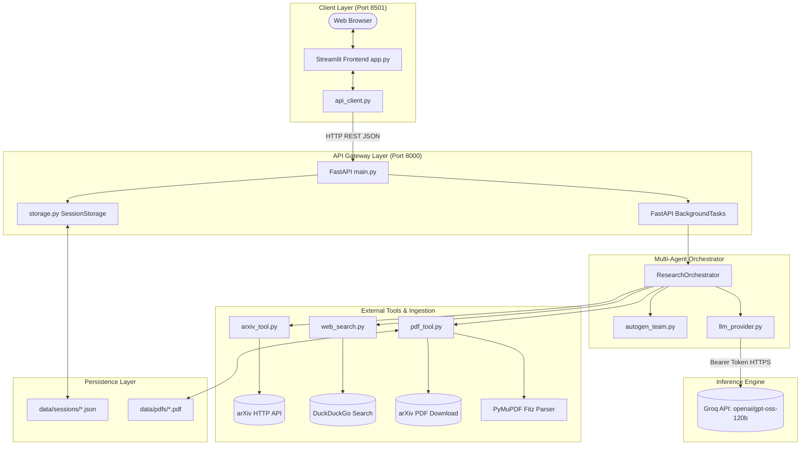
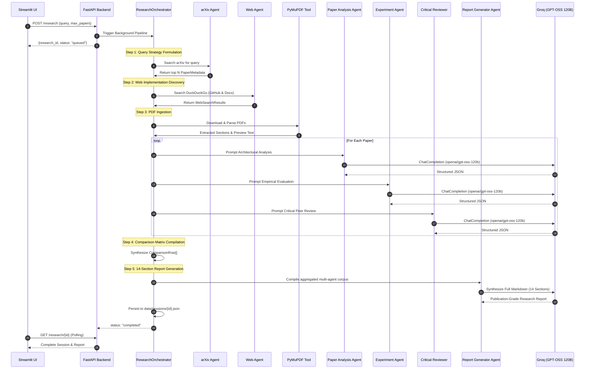

# Technical Requirements Document (TRD)
## ResearchPilot — Autonomous Multi-Agent Research Intelligence Platform

**Document Version:** 1.0.0  
**Project:** ResearchPilot  
**Status:** Approved / Architecture Baseline  
**Technical Author:** Lead AI & Platform Architect  

---

## 1. Technical Objective

This document defines the technical specifications, architectural boundaries, API contracts, data models, and non-functional engineering standards for **ResearchPilot**.

The system implements a decoupled, asynchronous client-server architecture:
- **Client:** Streamlit frontend (Python 3.13, Port 8501)
- **API Server:** FastAPI application with asynchronous background tasks (Port 8000)
- **Orchestration Layer:** AutoGen 0.9.4 multi-agent system
- **LLM Engine:** Groq API using `openai/gpt-oss-120b` (`GPT-OSS 120B (Medium)`)
- **Document & Web Ingestion:** `arxiv`, `ddgs`, and `pymupdf` (Fitz)

---

## 2. Technology Stack Specifications

| Layer | Component | Version | Role / Justification |
|---|---|---|---|
| **Language** | Python | 3.10 – 3.13 | Native async runtime, high ecosystem compatibility with AI libraries. |
| **API Framework** | FastAPI | >= 0.115.0 | Async request routing, OpenAPI generation, typed Pydantic validation. |
| **ASGI Server** | Uvicorn | >= 0.32.0 | High-performance ASGI web server for asynchronous concurrency. |
| **UI Framework** | Streamlit | >= 1.40.0 | Rapid reactive UI development with custom CSS theming. |
| **Agent Framework** | AutoGen | >= 0.9.0 | Multi-agent coordination, ConversableAgent message protocols. |
| **LLM Provider** | Groq Python SDK | >= 0.37.0 | Ultra-fast LPU inference (400+ tok/s) over OpenAI-compatible endpoints. |
| **Primary Model** | `openai/gpt-oss-120b` | N/A | High reasoning capacity, 120B parameter dense model on Groq. |
| **Academic Discovery** | `arxiv` | >= 4.0.0 | Official Python client for querying the arXiv API repository. |
| **Web Discovery** | `ddgs` | >= 9.16.0 | DuckDuckGo search library for GitHub codebases and technical docs. |
| **PDF Extraction** | PyMuPDF (`fitz`) | >= 1.24.0 | C-based, memory-efficient PDF text and section extraction engine. |
| **HTTP Client** | `httpx` / `requests` | >= 0.27.0 | Synchronous and asynchronous HTTP calls with connection pooling. |
| **Configuration** | `python-dotenv` | >= 1.0.0 | Environment variable loading from `.env`. |
| **Testing** | `pytest`, `pytest-asyncio` | >= 8.3.0 | Unit and integration test execution framework. |

---

## 3. System Architecture & Topology

### 3.1 Network Topology & Component Interactions



---

## 4. Data Models & Schemas (Pydantic)

All data structures are strongly typed using Pydantic v2 in [`backend/models.py`](file:///d:/ResearchPilot/backend/models.py).

### 4.1 Key Entities

#### `PaperMetadata`
Represents an academic paper discovered via arXiv:
```python
class PaperMetadata(BaseModel):
    title: str
    authors: List[str]
    abstract: str
    publication_date: str
    arxiv_id: str
    paper_url: str
    pdf_url: str
    categories: List[str] = []
    primary_category: str = ""
    local_pdf_path: Optional[str] = None
    extracted_text_preview: Optional[str] = None
```

#### `WebSearchResult`
Represents a practical codebase or technical tutorial discovered via DuckDuckGo:
```python
class WebSearchResult(BaseModel):
    title: str
    url: str
    snippet: str
    source_type: str = "general" # 'github' | 'docs' | 'blog' | 'general'
```

#### `PaperAnalysisResult`
Generated by the **Paper Analysis Agent**:
```python
class PaperAnalysisResult(BaseModel):
    paper_id: str
    title: str
    problem_statement: str
    motivation: str
    proposed_solution: str
    methodology: str
    architecture: str
    algorithms: str
    key_innovations: List[str]
```

#### `ExperimentResult`
Generated by the **Experiment Agent**:
```python
class ExperimentResult(BaseModel):
    paper_id: str
    title: str
    datasets: List[str]
    experimental_setup: str
    metrics: List[str]
    baselines: List[str]
    results: str
    ablation_studies: str
```

#### `CriticalReviewResult`
Generated by the **Critical Reviewer Agent**:
```python
class CriticalReviewResult(BaseModel):
    paper_id: str
    title: str
    limitations: List[str]
    missing_information: List[str]
    potential_weaknesses: List[str]
    open_questions: List[str]
    areas_for_investigation: List[str]
```

#### `ResearchReport`
The final 14-section publication-grade brief:
```python
class ResearchReport(BaseModel):
    research_topic: str
    executive_summary: str
    problem_statement: str
    research_motivation: str
    existing_approaches: str
    proposed_methodology: str
    architecture: str
    experimental_setup: str
    results: str
    comparison: str
    limitations: str
    open_research_questions: str
    implementation_considerations: str
    references: List[str]
    full_markdown: str
```

---

## 5. Multi-Agent System & Execution Lifecycle

### 5.1 AutoGen Team Topology
The system instantiates 7 specialized `autogen.AssistantAgent` instances and 1 `autogen.UserProxyAgent` acting as the coordinator:



---

## 6. External Tool Integrations

### 6.1 arXiv API Client (`backend/tools/arxiv_tool.py`)
- **Primary Mechanism:** `arxiv.Client(page_size=max_results, delay_seconds=1.0, num_retries=3)`
- **Query Strategy:** Relevance sorting over titles and abstracts (`SortCriterion.Relevance`).
- **Resilient Fallback:** If the `arxiv` python package experiences connection drops, queries are dynamically dispatched to the direct arXiv XML Atom feed (`http://export.arxiv.org/api/query`) using `httpx` and `xml.etree.ElementTree`.

### 6.2 DuckDuckGo Search Client (`backend/tools/web_search.py`)
- **Package:** `ddgs` (official DuckDuckGo Search client).
- **Multi-Query Strategy:** Generates 3 specialized search vectors:
  1. `<query> github repository code implementation` (Targets open-source code)
  2. `<query> architecture benchmark documentation` (Targets technical docs)
  3. `<query> technical guide survey tutorial` (Targets architectural deep-dives)
- **Classification Engine:** URL matching rules categorize hits into `github`, `docs`, `blog`, or `general`.
- **Curated Fallback:** If DuckDuckGo triggers an anti-scraping challenge or rate limit, contextual fallbacks to GitHub Search, PapersWithCode, and Hugging Face are returned.

### 6.3 PyMuPDF PDF Engine (`backend/tools/pdf_tool.py`)
- **Download Handler:** Streams binary chunks via `httpx.Client(timeout=30.0, follow_redirects=True)` with browser-compatible headers.
- **Cache Strategy:** Checks `data/pdfs/<arxiv_id>.pdf`. If cached and size > 1 KB, local disk read is used.
- **Memory Management:** Fitz reads documents directly into memory (`fitz.open(stream=..., filetype="pdf")`).
- **Token Budgeting:** Extracts the first 6–8 pages, capped at 16,000 characters to prevent LLM context saturation while preserving methodology and experiments.
- **Section Segmentation:** Regex heuristic extracts Introduction, Methodology, Experiments, and Conclusion blocks.

---

## 7. Storage & State Management

### 7.1 In-Memory & File Storage (`backend/storage.py`)
- **Hybrid Storage:**
  - `_memory_sessions: Dict[str, ResearchSession]` provides sub-millisecond status polling.
  - Disk persistence (`data/sessions/{research_id}.json`) guarantees zero state loss across server restarts.
- **Startup Sync:** Upon initialization, `SessionStorage` crawls `data/sessions/` and populates the memory cache.

---

## 8. Security & Secrets Architecture

1. **Server-Side API Key Storage:**
   - Groq API keys are loaded strictly via `load_dotenv('.env', override=True)` in `backend/config.py`.
   - The web frontend never transmits or requests API keys.
2. **CORS Configuration:**
   - FastAPI applies `CORSMiddleware` with explicit REST method whitelisting.
3. **File Path Traversal Protection:**
   - All PDF downloads and session writes resolve absolute paths strictly inside `data/` via `pathlib.Path.resolve()`.
4. **Git Protection:**
   - `.gitignore` explicitly blacklists `.env`, `*.log`, `data/sessions/*.json`, and `data/pdfs/*.pdf`.

---

## 9. Performance & Resource Budgets

| Metric | Target | Enforced Mechanism |
|---|---|---|
| **arXiv API Fetch** | < 2.5s | Timeout = 15.0s, Connection Pooling |
| **PDF Extraction** | < 1.0s per PDF | Fitz C-engine (PyMuPDF) in worker thread |
| **DuckDuckGo Search** | < 3.0s | Max 3 hits per sub-query, early exit |
| **Groq 120B Inference** | < 8.0s per call | Token throughput > 400 tok/s |
| **Status Polling Latency** | < 15ms | In-memory `Dict` lookup in FastAPI |
| **End-to-End Execution** | < 45–75s | Asynchronous parallel pipeline |
| **Memory Footprint** | < 300MB RAM | Streamed PDF reading, garbage collection |
